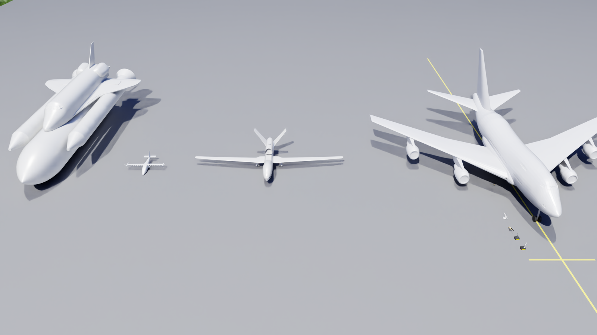
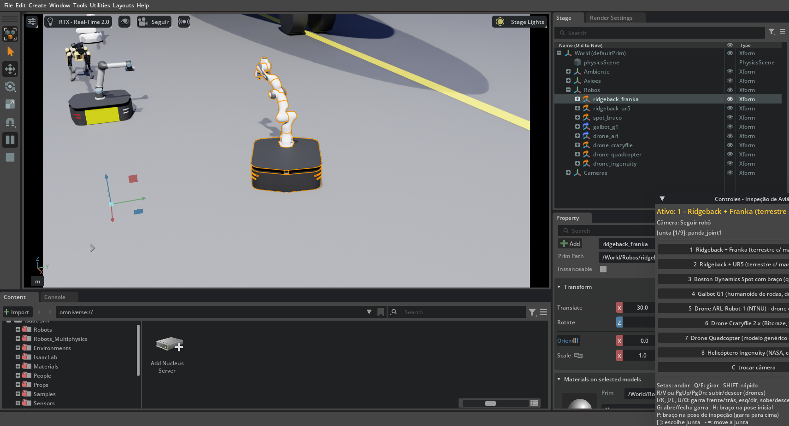
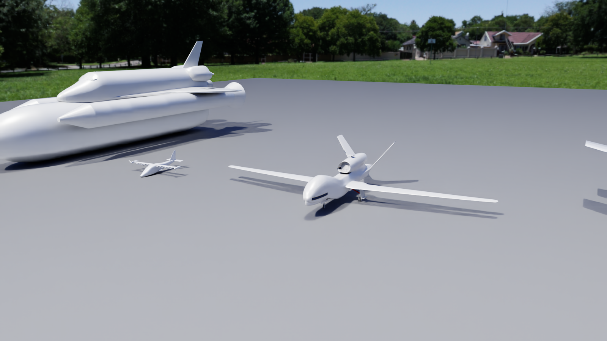
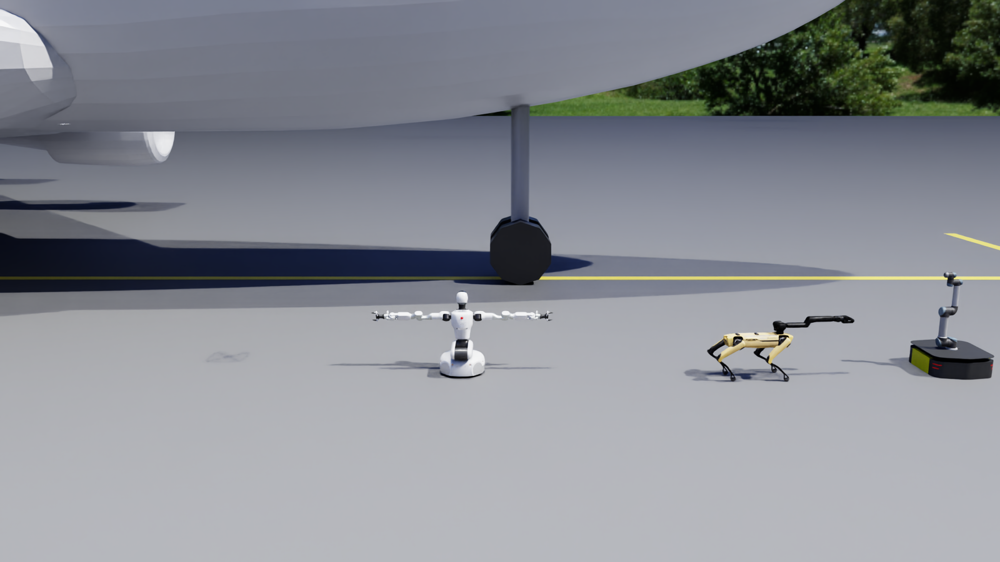
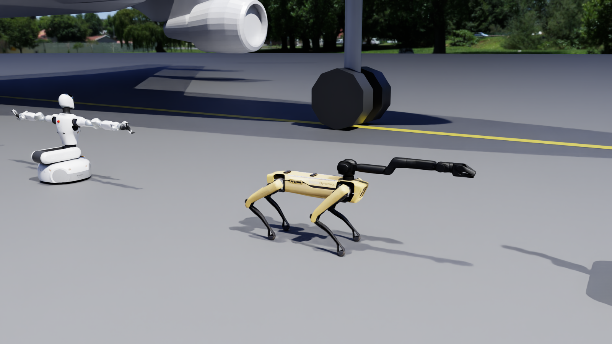
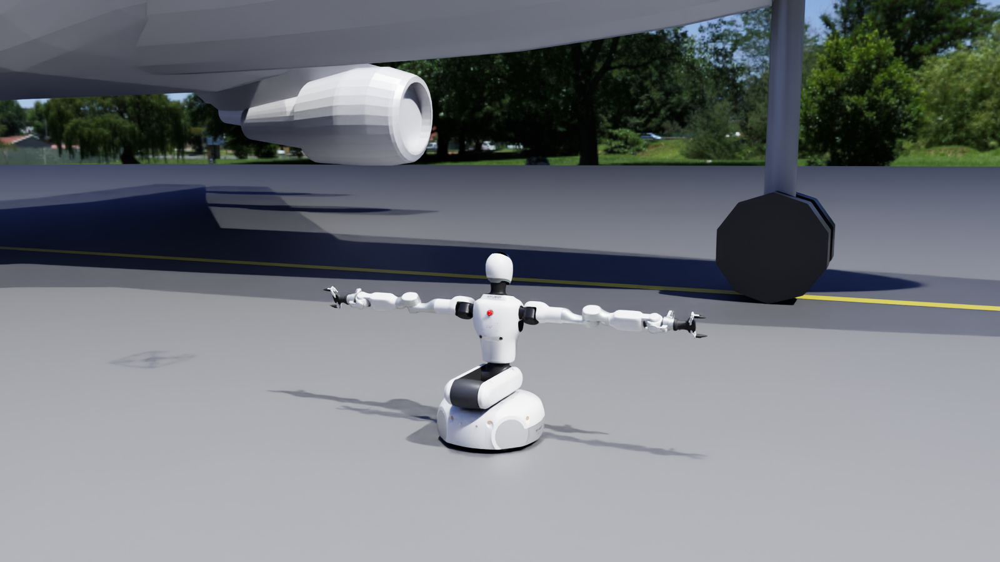
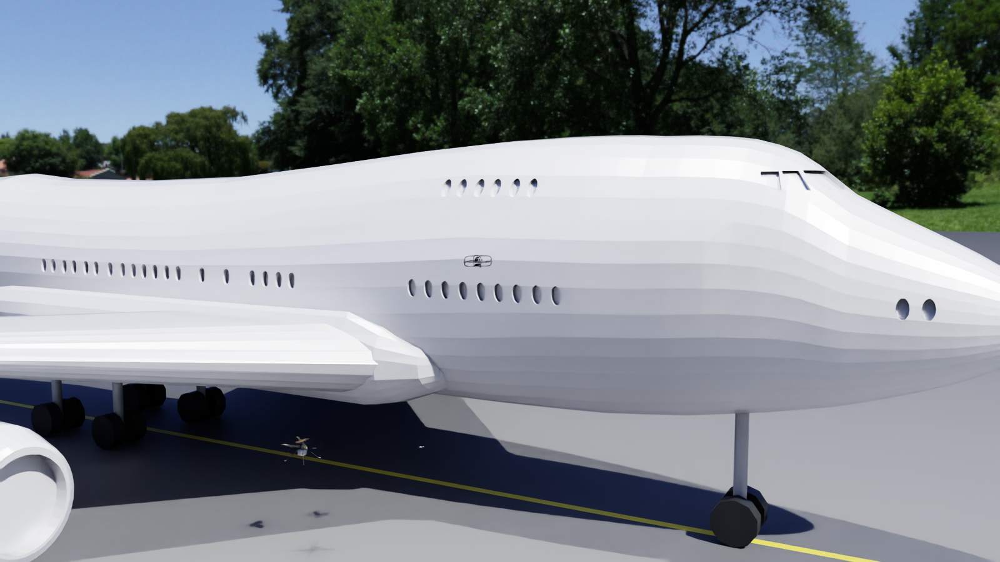
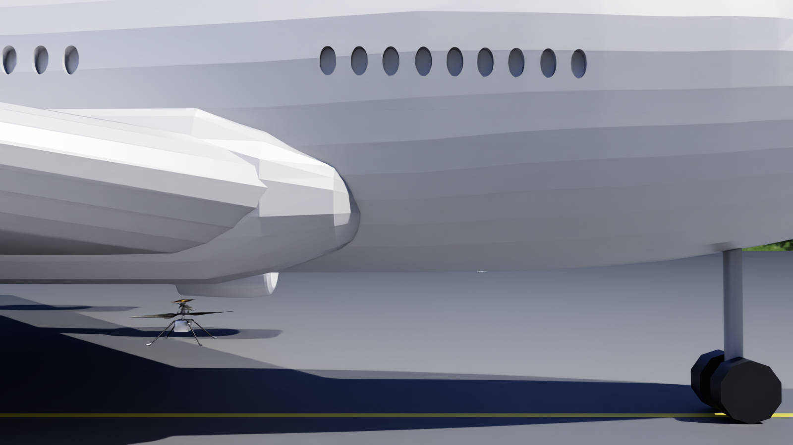
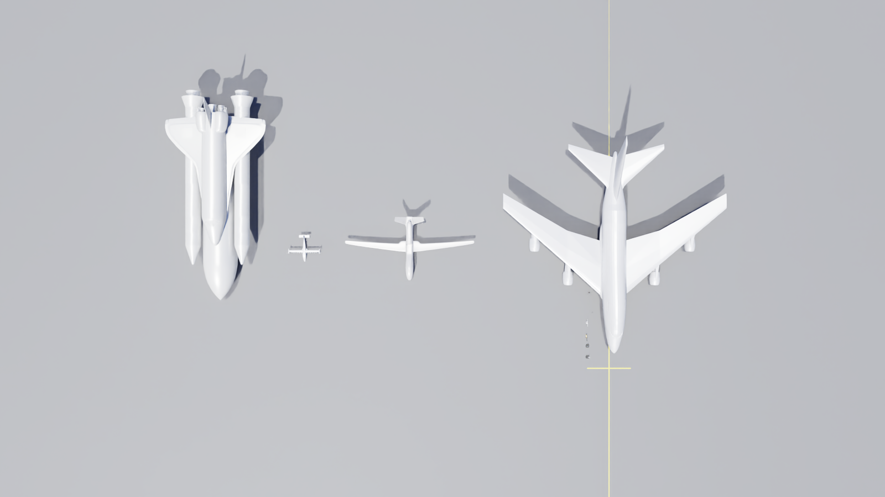

# Guia: Isaac Sim do zero + simulação de inspeção de avião

Este guia é para quem nunca usou o Isaac Sim. Ele explica como instalar, como mexer na interface e como abrir esta
simulação. A cena tem quatro aviões estáticos lado a lado (o principal é um Boeing 747SP), quatro robôs terrestres
com manipulador e quatro drones. Todos os robôs são controláveis pelo teclado.



---

## Sumário

1. [O que tem nesta pasta](#1-o-que-tem-nesta-pasta)
2. [Instalando o Isaac Sim 6.1 do zero](#2-instalando-o-isaac-sim-61-do-zero)
3. [Primeiros passos na interface do Isaac Sim](#3-primeiros-passos-na-interface-do-isaac-sim)
4. [Abrindo o projeto](#4-abrindo-o-projeto)
5. [Controles do teclado](#5-controles-do-teclado)
6. [O que existe na cena](#6-o-que-existe-na-cena)
7. [Como a simulação funciona (e as simplificações)](#7-como-a-simulação-funciona-e-as-simplificações)
8. [Comandos úteis: imagens, autoteste, gravar a cena](#8-comandos-úteis)
9. [Trocar ou adicionar um avião](#9-trocar-ou-adicionar-um-avião)
10. [Problemas comuns](#10-problemas-comuns)
11. [Créditos e licenças](#11-créditos-e-licenças)

Controle por código (missões e servidor TCP), gravação de vídeo e dados e alterações na cena estão no
**[DESENVOLVIMENTO.md](DESENVOLVIMENTO.md)**.

---

## 1. O que tem nesta pasta

```
inspecao_aviao/
├── executar.sh                 ← ABRE A SIMULAÇÃO (robôs e drones controláveis)
├── abrir_cena.sh               ← abre um arquivo USD só para olhar (sem controle)
├── GUIA_ISAAC_SIM.md           ← este guia
├── DESENVOLVIMENTO.md          ← controle por código, gravação, alterar a cena, adicionar robôs
├── README.md                   ← resumo rápido
├── scripts/
│   ├── inspecao_aviao.py       ← monta a cena e controla os robôs (o "programa" principal)
│   ├── api_externa.py          ← API para missões, servidor TCP, gravação de vídeo e CSV
│   ├── abrir_cena.py           ← usado pelo abrir_cena.sh
│   └── converter_avioes.py     ← converte os modelos da NASA (.glb/.stl) para USD
├── exemplos/
│   ├── missao_inspecao.py      ← missão automática: drone e Ridgeback inspecionam o 747
│   └── cliente_tcp.py          ← controla a simulação de outro programa, pela rede
├── cenas/
│   └── cena_inspecao_aviao.usda ← a cena completa gravada em USD (abre no Isaac Sim)
├── assets/avioes/
│   ├── originais/              ← arquivos baixados da NASA (glb/stl + preview.png)
│   └── usd/                    ← aviões convertidos para USD, em escala real e com colisão
└── imagens/                    ← capturas do ambiente (geradas pela própria simulação)
```

O **USD** (Universal Scene Description) é o formato de cena do Isaac Sim, criado pela Pixar. Um arquivo `.usd` ou
`.usda` (versão em texto) guarda geometria, materiais, física, câmeras e luzes.

---

## 2. Instalando o Isaac Sim 6.1 do zero

> Se o Isaac Sim já está instalado (como no PC onde este projeto foi feito, em `~/isaacsim-projeto/env_isaacsim61`),
> pule para a [seção 3](#3-primeiros-passos-na-interface-do-isaac-sim).

### 2.1 Requisitos

| Item | Mínimo / recomendado |
|---|---|
| Sistema | Ubuntu 22.04 ou 24.04 (GLIBC ≥ 2.35; confira com `ldd --version`) |
| Placa de vídeo | NVIDIA **RTX** (o Isaac Sim usa ray tracing) |
| Driver NVIDIA | recente. Veja com `nvidia-smi` |
| Python | **3.12** |
| Disco | ~30 GB livres (Isaac Sim + cache de shaders e assets) |
| Internet | necessária na 1ª execução: robôs e céu vêm da nuvem da NVIDIA e depois ficam em cache |

### 2.2 Instalação via pip (recomendada)

Num terminal:

```bash
# 1) ambiente virtual Python 3.12
sudo apt install python3.12-venv          # se ainda não tiver
mkdir -p ~/isaacsim-projeto && cd ~/isaacsim-projeto
python3.12 -m venv env_isaacsim61
source env_isaacsim61/bin/activate
pip install --upgrade pip

# 2) PyTorch com CUDA (escolha UMA linha conforme o CUDA do driver; `nvidia-smi` mostra "CUDA Version")
pip install torch==2.11.0 --index-url https://download.pytorch.org/whl/cu130   # CUDA 13
# pip install torch==2.11.0 --index-url https://download.pytorch.org/whl/cu128 # CUDA 12

# 3) Isaac Sim 6.1 completo (vários GB, demora)
pip install "isaacsim[all,extscache]==6.1.0.0" --extra-index-url https://pypi.nvidia.com
```

Se você instalar em outro caminho, avise os scripts com a variável `ISAACSIM_ENV`:
`ISAACSIM_ENV=/caminho/do/env ./executar.sh`

### 2.3 Primeira execução

```bash
source ~/isaacsim-projeto/env_isaacsim61/bin/activate
export OMNI_KIT_ACCEPT_EULA=YES     # aceita a licença (EULA) do Omniverse sem perguntar
isaacsim                            # abre a interface do Isaac Sim
```

* Na **primeira vez** ele compila os shaders e pode levar de 5 a 15 minutos, com a janela parecendo travada. Isso
  é normal. Nas próximas vezes abre em cerca de 1 minuto.
* Para conferir se a máquina é compatível: `isaacsim isaacsim.exp.compatibility_check`.

---

## 3. Primeiros passos na interface do Isaac Sim



| Área | Para que serve |
|---|---|
| **Viewport** (centro) | a vista 3D da cena |
| **Stage** (direita, em cima) | a "árvore" da cena: `World → Ambiente, Avioes, Robos, Cameras`. Clique num item para selecioná-lo |
| **Property** (direita, embaixo) | propriedades do item selecionado (posição, material, física...) |
| **Content** (embaixo) | navegador de arquivos; a pasta *Isaac Sim* tem todos os robôs/ambientes oficiais da NVIDIA |
| Barra lateral esquerda | **Play ▶ / Pause / Stop ■** da simulação física e ferramentas de mover/girar/escalar |
| Menu **Window** | reabre painéis fechados (ex.: *Window → Stage*) |

**Navegando no viewport (com o mouse sobre ele):**

| Ação | Como |
|---|---|
| Girar a câmera em volta | **Alt + botão esquerdo** e arrastar |
| Arrastar (pan) | **botão do meio** e arrastar |
| Zoom | **roda do mouse** |
| "Voar" como em jogo | segure o **botão direito** e use **W A S D** (Q/E sobe/desce) |
| Centralizar no objeto selecionado | selecione no Stage e aperte **F** |
| Trocar a câmera do viewport | ícone de câmera no topo do viewport (ex.: "Perspective", "Seguir") |

**Conceitos rápidos:**
* **Play** liga a física (gravidade, colisões, motores). **Stop** volta tudo ao estado inicial.
* **Articulação** é um robô feito de corpos rígidos ligados por juntas (o braço Franka, o Spot...).
* Arquivos de robôs oficiais ficam na nuvem (`https://omniverse-content-production.../Assets/Isaac/6.1/Isaac/Robots/...`).
  No painel **Content → Isaac Sim → Robots** dá para arrastar qualquer robô para a cena.

---

## 4. Abrindo o projeto

### 4.1 Simulação controlável (o modo principal)

```bash
cd inspecao_aviao
./executar.sh
```

1. Espere a cena carregar (1 a 3 minutos na primeira vez, porque baixa os robôs da nuvem).
2. Aparece a janela **"Controles - Inspeção de Avião"**, com a lista de robôs e as teclas.
3. **Clique uma vez no viewport** (para ele receber o teclado) e use as teclas da [seção 5](#5-controles-do-teclado).
   A física já está rodando, não precisa apertar Play.

Opções úteis:

```bash
./executar.sh --cena leve        # só 747 + Ridgeback/Franka + drone ARL (PC com pouca memória de vídeo)
./executar.sh --robos ridgeback_franka,drone_arl     # escolher quais robôs carregar
./executar.sh --help             # todas as opções
```

Nomes para `--robos`: `ridgeback_franka`, `ridgeback_ur5`, `spot_braco`, `galbot_g1`, `drone_arl`,
`drone_crazyflie`, `drone_quadcopter`, `drone_ingenuity`.

### 4.2 Só olhar os modelos (sem controle)

```bash
./abrir_cena.sh                                                 # a cena completa
./abrir_cena.sh assets/avioes/usd/sofia_747sp/sofia_747sp.usd    # só o 747
./abrir_cena.sh assets/avioes/usd/global_hawk/global_hawk.usd    # só o Global Hawk
./abrir_cena.sh assets/avioes/usd/x57_maxwell/x57_maxwell.usd    # só o X-57
./abrir_cena.sh assets/avioes/usd/space_shuttle/space_shuttle.usd
```

Também dá para abrir pelo próprio Isaac Sim: rode `isaacsim`, vá em **File → Open** e escolha
`cenas/cena_inspecao_aviao.usda` (ou qualquer `.usd` de `assets/avioes/usd/`).

> Abrindo a cena desse jeito, os robôs **não têm controlador**. Se apertar Play, os robôs terrestres ficam parados
> e os drones flutuam (a gravidade deles está desligada). Para pilotar, use o `./executar.sh`.

### 4.3 Ver os robôs e drones originais da NVIDIA

No Isaac Sim, painel **Content → Isaac Sim → Robots**:

| Robô | Caminho dentro de *Robots* |
|---|---|
| Ridgeback + Franka | `Clearpath/RidgebackFranka/ridgeback_franka.usd` |
| Ridgeback + UR5 | `Clearpath/RidgebackUr/ridgeback_ur5.usd` |
| Spot com braço | `BostonDynamics/spot/spot_with_arm.usd` |
| Galbot G1 | `Galbot/galbot_g1/galbot_g1.usda` |
| Drone ARL-Robot-1 | `NTNU/ARL-Robot-1/arl_robot_1.usd` |
| Crazyflie | `Bitcraze/Crazyflie/cf2x.usd` |
| Quadcopter | `IsaacSim/Quadcopter/quadcopter.usd` |
| Ingenuity | `NASA/Ingenuity/ingenuity.usd` |

---

## 5. Controles do teclado

Um robô é controlado por vez; os outros ficam parados segurando a posição.

| Tecla | Ação |
|---|---|
| **TAB** ou **1 … 8** | troca o robô ativo (ou clique no botão do robô na janela Controles) |
| **C** | troca a câmera: *Panorâmica* → *Seguir robô* → *Câmera do robô* (câmera de bordo) |
| **Setas ↑ ↓** | anda para frente / para trás |
| **Setas ← →** | anda de lado (todos os robôs daqui são omnidirecionais) |
| **Q / E** | gira para a esquerda / direita |
| **R / V** ou **PageUp / PageDown** | sobe / desce (drones) |
| **SHIFT** (segurado) | mais rápido |
| **I / K** | garra para frente / para trás (braço Franka/UR5, IK cartesiano) |
| **J / L** | garra para a esquerda / direita |
| **U / O** | garra para cima / para baixo |
| **P** | braço na **pose de inspeção** (garra apontando para cima, para olhar motor/asa por baixo) |
| **H** | braço de volta à pose inicial |
| **G** | abre / fecha a garra (Franka) |
| **[ / ]** | escolhe uma junta (modo junta; a junta atual aparece na janela Controles) |
| **- / =** | move a junta escolhida (serve para o braço do UR5/Franka, o braço do Spot e os braços/tronco/cabeça do Galbot) |
| **BACKSPACE** | devolve o robô ativo para a posição inicial |

**Dicas para a demonstração de inspeção:**
1. Robô **1** (Ridgeback + Franka) começa na fila, ao lado do nariz do 747. Leve-o com as setas até embaixo de um
   motor (o motor interno esquerdo fica em x ≈ 5 m, y ≈ −12 m; ande para trás e gire com Q/E). Aperte **P**, depois
   **C** duas vezes (câmera do robô) e você vê a nacele e a asa por baixo, pela câmera da garra.
2. Robô **5** (drone ARL): segure **R** para subir até ~7 m. Ele já começa virado para a fuselagem do 747. Use as
   setas para contorná-la e **C** para a câmera de bordo (aponta para a frente do drone).

---

## 6. O que existe na cena

### 6.1 Aviões (4, todos estáticos, com colisão)

Os aviões ficam lado a lado, todos com o nariz para +X: o 747 no centro (y = 0) e os outros em fila no lado −Y. Eles
não se mexem; servem de alvo de inspeção, e os robôs e drones colidem com todos eles.

| Avião | Onde está | Dimensões no modelo (C × E × A) | Origem |
|---|---|---|---|
| **NASA SOFIA – Boeing 747SP** (principal) | centro (y = 0) | 56,3 × 59,6 × 18,9 m | NASA 3D Resources (modelo de impressão 3D em 7 partes .stl) |
| NASA Global Hawk (RQ-4A) | ao lado do 747 (y = −55 m) | 17,4 × 35,4 × 6,3 m | NASA 3D Resources (.glb) |
| NASA X-57 Maxwell | ao lado do Global Hawk (y = −84 m) | 7,4 × 9,6 × 2,7 m | NASA 3D Resources (.glb) |
| Space Shuttle (orbitador + tanque + boosters) | ponta da fila (y = −106 m) | 56,1 × 26,5 × 19,1 m | NASA 3D Resources (.glb) |

O Isaac Sim **não traz nenhum modelo de avião**. Estes foram os modelos gratuitos que dava para baixar sem login.
Alternativas com mais detalhe (Sketchfab, CGTrader) exigem conta e é preciso conferir a licença; veja a
[seção 9](#9-trocar-ou-adicionar-um-avião).



### 6.2 Robôs terrestres com manipulador

Os 8 robôs (terrestres e drones) começam em fila, lado a lado, a 6 m do eixo do 747 (y = −6 m), entre x = 30 m e
x = 12 m, virados para a fuselagem.



| # | Robô | Locomoção | Manipulador | Câmera de bordo |
|---|---|---|---|---|
| 1 | **Clearpath Ridgeback + Franka Panda** | base omnidirecional | 7 eixos + garra, IK cartesiano (I/K/J/L/U/O), pose de inspeção (P) | na garra |
| 2 | Clearpath Ridgeback + UR5 | base omnidirecional | 6 eixos, IK cartesiano, pose de inspeção | no punho |
| 3 | Boston Dynamics Spot com braço | **anda de verdade** com a política de IA da NVIDIA | braço pelo modo junta | na frente do corpo |
| 4 | Galbot G1 | base com rodas omni (movida cinematicamente) | 2 braços de 7 eixos + tronco + cabeça (modo junta) | — |

| Spot com braço | Galbot G1 |
|---|---|
|  |  |

### 6.3 Drones

| # | Drone | Tamanho | Observação |
|---|---|---|---|
| 5 | **ARL-Robot-1 (NTNU)** | 0,5 m | o "drone de inspeção" principal, com câmera de bordo |
| 6 | Crazyflie 2.x (Bitcraze) | 9 cm | nano-drone; hélices giram ao voar |
| 7 | Quadcopter (modelo genérico do Isaac Sim) | ~1 m | o asset original tem 20 m; aplicamos escala 0,05 |
| 8 | Ingenuity (NASA) | 1,2 m | helicóptero coaxial de Marte; rotores giram ao voar |

| Drone inspecionando a fuselagem | Frota de drones |
|---|---|
|  |  |



---

## 7. Como a simulação funciona (e as simplificações)

O `scripts/inspecao_aviao.py` faz quatro coisas:

1. **Monta a cena** em USD: chão (plano de colisão do PhysX), céu HDR, sol, aviões (arquivos locais) e robôs
   (nuvem da NVIDIA).
2. **Roda a física** PhysX na CPU a **500 Hz**. Essa é a frequência em que a política do Spot foi treinada.
3. **A cada passo de física**, chama o controlador do tipo de cada robô (`Ridgeback`, `Spot`, `Galbot`, `Drone`).
4. **Lê o teclado** (carb.input), atualiza a câmera "seguir" e a janela de Controles.

Simplificações. São escolhas para a demonstração funcionar de forma estável; vale saber antes de tirar conclusões
de engenharia:

* **Drones:** usam um controlador em modo *position hold*, como o modo "Position/Loiter" de uma controladora de voo.
  O operador comanda velocidades e o controlador mantém altitude, posição e atitude nivelada. A gravidade dos drones
  está desligada e o voo é feito impondo velocidades ao corpo. **Não há** modelo de motor, hélice ou aerodinâmica.
  As colisões com os aviões e o chão continuam valendo. Para dinâmica realista (empuxo por motor, PX4), os
  próximos passos seriam o [Pegasus Simulator](https://pegasussimulator.github.io/PegasusSimulator/) (hoje até o
  Isaac Sim 5.1) ou o multirrotor do Isaac Lab (`isaaclab_contrib`, já instalado).
* **Spot com braço:** anda com a política de locomoção oficial da NVIDIA, que foi treinada **sem braço**. Para ele
  ficar de pé com o braço, o script faz três ajustes: move a raiz da articulação para o corpo (`base`) (no USD
  original a raiz caía no ombro do braço), desliga a autocolisão (as pernas batiam no braço ao girar) e deixa os
  links do braço com 0,05 kg. O braço é controlado pelo modo junta. Movimentos bruscos do braço podem derrubá-lo; se
  cair, aperte **BACKSPACE**.
* **Ridgeback (Franka e UR5):** a base anda por três juntas virtuais (x, y e giro), que é como o asset da NVIDIA é
  montado. As rodas não fazem força no chão. A colisão dos cilindros das rodas do UR5 foi desligada (ficavam 2,6 cm
  abaixo do chão e travavam o robô). O alcance do Franka é ~0,85 m: alcança motor, trem de pouso e a parte de baixo
  da fuselagem; para as partes altas use os drones.
* **Galbot G1:** a base é movida cinematicamente (posição imposta a cada passo), não pelas rodas omni. O asset traz
  um controlador OmniGraph próprio, que desativamos.
* **747 SOFIA:** é um modelo feito para impressão 3D. Não tem pintura (é branco) nem trem de pouso; colocamos um trem
  de pouso simplificado (cilindros) e suspendemos o avião a uma altura realista (motores internos a 1,4 m do chão).
* **Global Hawk:** foi escalado pela envergadura real (35,4 m); pelas proporções do modelo, o comprimento ficou com
  17,4 m (o real é ~14,5 m).
* **Colisão dos aviões:** cada avião tem uma malha de colisão simplificada (até 40 mil triângulos, invisível), além
  da malha visual.

---

## 8. Comandos úteis

```bash
# Gerar de novo as imagens da pasta imagens/ (sem janela; os drones decolam e os braços vão à pose de inspeção)
./executar.sh --headless --capturas imagens

# Autoteste: "aperta" teclas em cada robô e mostra se andou, girou, subiu, mexeu junta
./executar.sh --headless --autoteste

# Gravar a cena montada num arquivo USD (para abrir depois com File → Open)
./executar.sh --headless --frames 1 --salvar cenas/cena_inspecao_aviao.usda

# Missão automática com vídeo, fotos e CSV em saidas/ (ver DESENVOLVIMENTO.md)
./executar.sh --headless --cena leve --missao exemplos/missao_inspecao.py \
    --gravar-video saidas/missao.mp4 --log-csv saidas/missao.csv
```

Missões, servidor TCP, gravação e como alterar a cena estão explicados no [DESENVOLVIMENTO.md](DESENVOLVIMENTO.md).

Resultado esperado do autoteste:

```
ridgeback_franka: andou 2.00 m, girou +69 graus, garra subiu +0.10 m, junta 'panda_joint1' moveu +0.50 rad
ridgeback_ur5:    andou 2.00 m, girou +69 graus, garra subiu +0.13 m, junta 'ur_arm_shoulder_pan_joint' moveu +0.50 rad
spot_braco:       andou 2.07 m, girou +85 graus, junta 'arm0_sh0' moveu +0.45 rad | altura 0.49 m, inclinação 3 graus
galbot_g1:        andou 1.60 m, girou +69 graus, junta 'left_arm_joint1' moveu +0.50 rad
drone_arl:        andou 5.00 m, girou +69 graus, subiu +2.52 m
drone_crazyflie:  andou 2.00 m, girou +69 graus, subiu +1.20 m
drone_quadcopter: andou 5.00 m, girou +69 graus, subiu +2.51 m
drone_ingenuity:  andou 5.00 m, girou +69 graus, subiu +2.21 m
```

Os drones maiores sobem menos que 3 m no teste porque, ao andar 5 m para a frente, encostam na fuselagem do 747. Isso
é a colisão funcionando: eles começam virados para o avião.

---

## 9. Trocar ou adicionar um avião

Os `.glb` da NASA usam compressão **Draco**, que o conversor do Isaac Sim (*File → Import*) não lê: ele gera um USD
vazio. Por isso existe o `scripts/converter_avioes.py`, que lê os arquivos com o Open3D (já vem no ambiente do Isaac
Sim) e grava USD em metros, com Z para cima, nariz em +X, apoiado no chão, em escala real e com colisão.

Para adicionar um avião novo:

1. Coloque o arquivo (`.glb`, `.gltf`, `.obj` ou `.stl`) em `assets/avioes/originais/<nome>/`.
2. Em `scripts/converter_avioes.py`, copie um bloco do dicionário `AVIOES` e ajuste:
   * `R`: matriz que leva os eixos do arquivo para (frente, esquerda, cima);
   * `medida`: `("comprimento", metros)` ou `("envergadura", metros)` reais.
3. Rode `source ~/isaacsim-projeto/env_isaacsim61/bin/activate && python scripts/converter_avioes.py <nome>`.
4. Em `scripts/inspecao_aviao.py`, função `build_aircraft`, adicione `("<nome>", (x, y, 0), yaw)` ao `layout`.

Arquivos **sem** Draco (a maioria dos `.fbx`/`.obj`/`.gltf` de sites como Sketchfab) também podem ser importados
direto pelo Isaac Sim: **File → Import**, ou o painel *Content* com botão direito → *Convert to USD*.

Opções de modelos mais detalhados (precisam de login; confira a licença antes de usar):
* Sketchfab, [Airbus A320 LATAM (CC-BY)](https://sketchfab.com/3d-models/airbus-a320-latam-very-detailed-90e96888c7f04f46bd76352a01ac2ad6)
  e [A380-800](https://sketchfab.com/3d-models/airbus-a380-800-model-without-landing-gear-15bf2a45aa2c4676b658ac43c8a1137b).
* CGTrader, modelos "free" de Boeing 737 (cada um tem a sua licença).

---

## 10. Problemas comuns

| Sintoma | Solução |
|---|---|
| Janela "não responde" na 1ª execução | está compilando shaders; espere (até ~15 min) |
| `Não encontrei o ambiente do Isaac Sim` | o Isaac Sim está em outro lugar: `ISAACSIM_ENV=/caminho/env ./executar.sh` |
| Robôs/céu não aparecem, ou erro "assets root" | precisa de internet na 1ª vez (assets vêm da nuvem da NVIDIA); depois fica em cache |
| O teclado não faz nada | clique no viewport (área 3D) antes; não segure o botão direito do mouse (ele ativa o modo "voar" da câmera) |
| Muito lento / falta memória de vídeo | `./executar.sh --cena leve`; feche outros programas que usam a GPU |
| O Spot caiu | **BACKSPACE** com o Spot ativo (tecla 3) devolve ele de pé |
| Um drone ficou preso no avião | afaste com as setas ou **BACKSPACE** |
| Mensagens `[Warning]` no terminal | normais no Isaac Sim; só `[Error]` com *Traceback* indica problema |

---

## 11. Créditos e licenças

* **Aviões:** [NASA 3D Resources](https://nasa3d.arc.nasa.gov/) ([GitHub](https://github.com/nasa/NASA-3D-Resources)),
  de uso livre conforme as diretrizes da NASA. O uso não implica endosso da NASA, e o logotipo da NASA não pode ser
  usado para sugerir patrocínio.
* **Robôs, drones, céu e política do Spot:** assets da NVIDIA Isaac Sim / Omniverse, distribuídos sob os
  termos de licença do Isaac Sim.
* **Software:** NVIDIA Isaac Sim 6.1 (PhysX, RTX), Open3D (leitura dos modelos Draco), OpenUSD.
