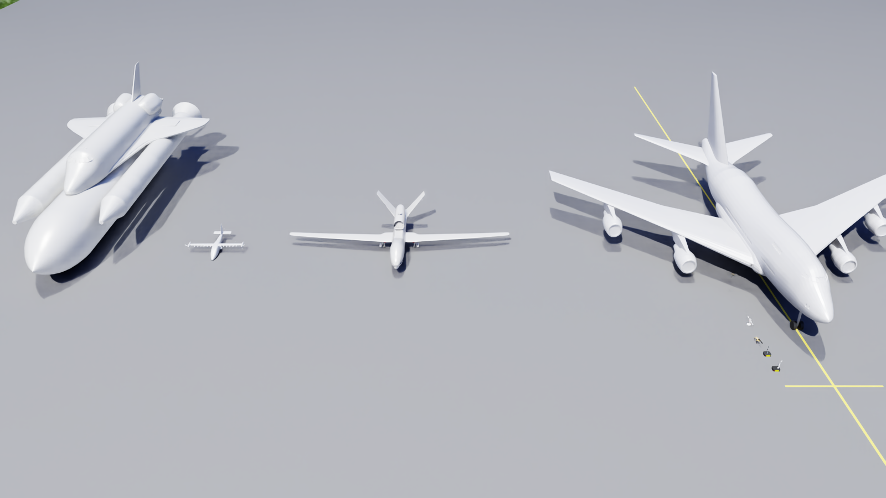
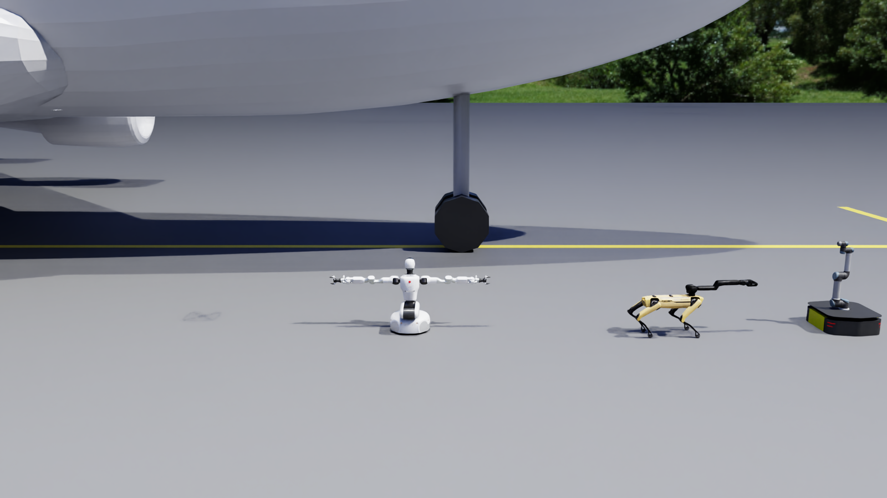
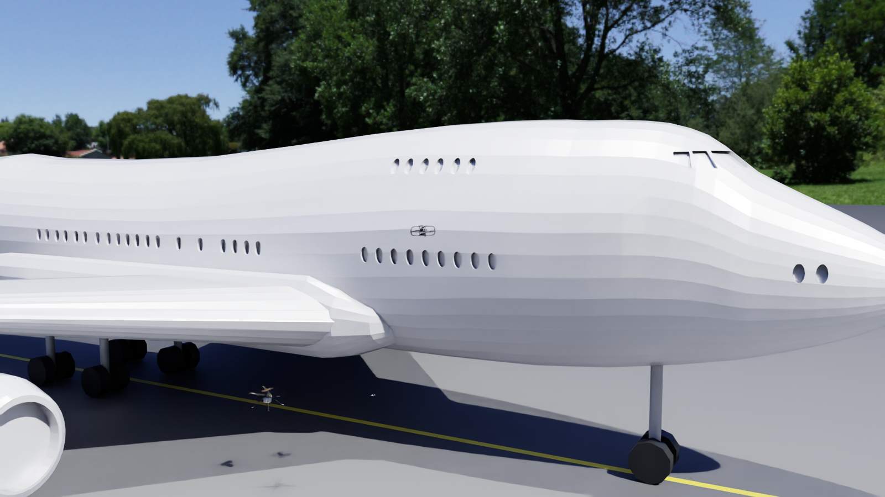
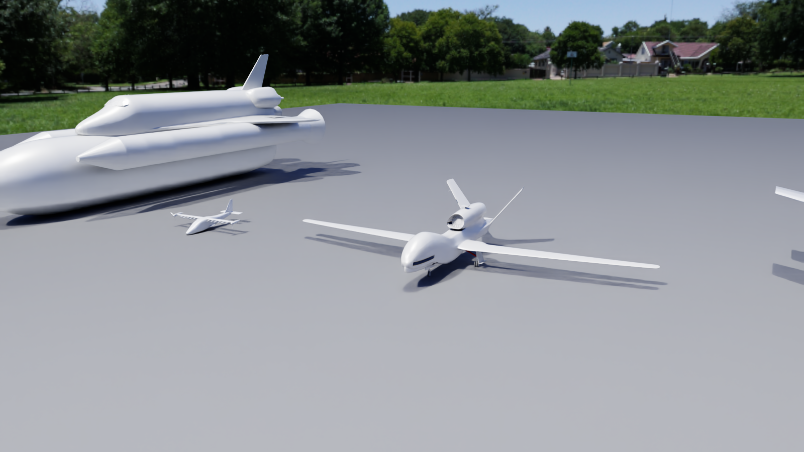
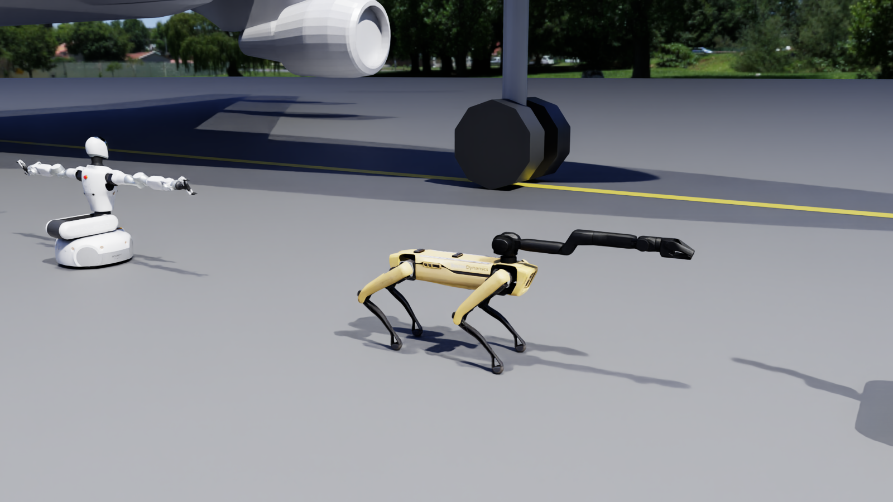
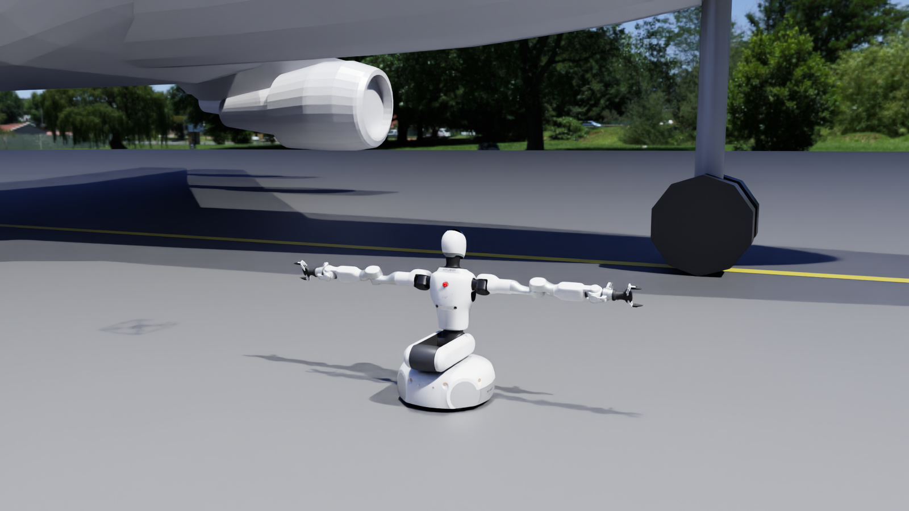
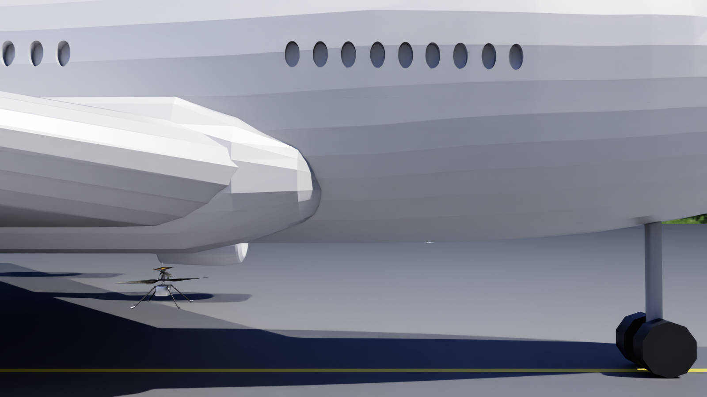

# Inspeção de avião com robô terrestre + manipulador e drones (Isaac Sim 6.1)



Simulação no NVIDIA Isaac Sim 6.1 com:

* **4 aviões estáticos lado a lado**, em escala real e com colisão: NASA SOFIA (Boeing 747SP, o principal), Global
  Hawk, X-57 Maxwell e Space Shuttle.
* **4 robôs terrestres com manipulador:** Ridgeback + Franka, Ridgeback + UR5, Spot com braço e Galbot G1.
* **4 drones:** ARL-Robot-1, Crazyflie, Quadcopter e Ingenuity.
* Os 8 robôs ficam em fila, lado a lado, junto à fuselagem do 747.
* **Controle de todos pelo teclado**, com câmera que segue o robô e câmeras de bordo (garra do braço, frente do drone).

## Início rápido

```bash
cd inspecao_aviao
./executar.sh            # abre a simulação; clique no viewport e use TAB, setas, Q/E, R/V, P, C ...
./abrir_cena.sh          # só para olhar a cena/modelos no Isaac Sim (sem controle)
```

Leia o **[GUIA_ISAAC_SIM.md](GUIA_ISAAC_SIM.md)**. Ele cobre a instalação do Isaac Sim do zero, a interface, as
teclas, o que tem na cena, as simplificações e a solução de problemas.

Para programar em cima da simulação, veja o **[DESENVOLVIMENTO.md](DESENVOLVIMENTO.md)**: missões automáticas em
Python, controle por outro programa (servidor TCP/JSON), gravação de vídeo, fotos e poses em CSV, como tirar ou
colocar coisas na cena e como adicionar um robô.

```bash
# exemplo: drone e Ridgeback inspecionam o 747 sozinhos; grava vídeo, fotos e poses em saidas/
./executar.sh --cena leve --missao exemplos/missao_inspecao.py --gravar-video saidas/missao.mp4 --log-csv saidas/missao.csv
```

| | | |
|---|---|---|
|  |  |  |
|  |  |  |
# inspecao_aviao
